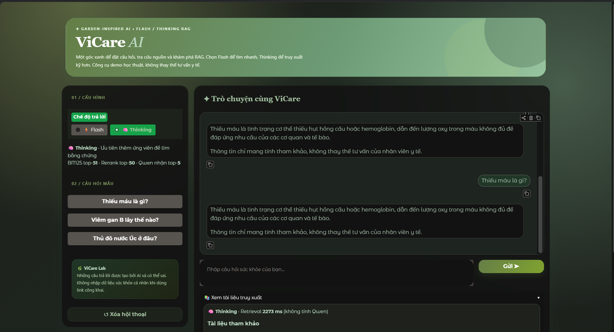
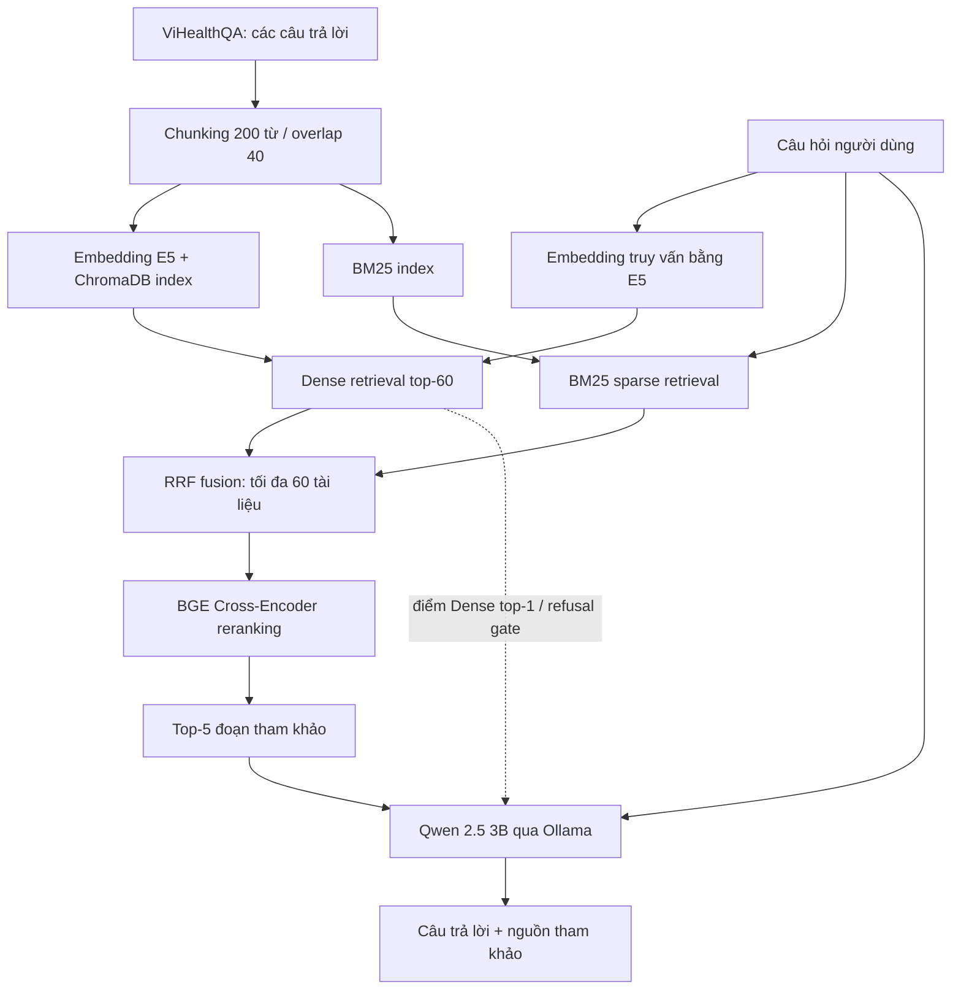

# ViCare AI — Vietnamese Healthcare RAG

> **ViCare** là dự án demo học thuật về hỏi đáp thông tin sức khỏe bằng tiếng Việt, được xây dựng với **Retrieval-Augmented Generation (RAG)**. Hệ thống tìm thông tin từ kho tài liệu trước khi sử dụng mô hình ngôn ngữ để tạo câu trả lời, đồng thời hiển thị nguồn tham khảo.

**⚠️ Tuyên bố sử dụng:** ViCare là sản phẩm học tập và nghiên cứu, **không phải công cụ chẩn đoán, kê đơn hoặc thay thế tư vấn của nhân viên y tế**. Không nhập thông tin sức khỏe cá nhân thật vào đường dẫn demo công khai.



## 1. Bài toán và giải pháp

Mô hình ngôn ngữ có thể trả lời thiếu căn cứ hoặc đưa thông tin không xuất hiện trong nguồn tham khảo. ViCare thử nghiệm cách kết hợp tìm kiếm ngữ nghĩa, tìm kiếm từ khóa và xếp hạng lại tài liệu để bổ sung ngữ cảnh cho mô hình sinh.

Người dùng nhập câu hỏi tiếng Việt, chọn **⚡ Flash** hoặc **🧠 Thinking**, rồi nhận câu trả lời ngắn cùng danh sách nguồn đã truy xuất. Nếu thiếu căn cứ theo cơ chế kiểm tra được triển khai, hệ thống có thể từ chối trả lời.

## 2. Pipeline RAG



**Thành phần kỹ thuật:**

| Tầng | Công nghệ / vai trò |
|---|---|
| Dataset | [`tarudesu/ViHealthQA`](https://huggingface.co/datasets/tarudesu/ViHealthQA) — các trường `id`, `question`, `answer`, `link` |
| Chunking | Chia riêng từng Answer, tối đa **200 từ**, overlap **40 từ**; không ghép các Answer khác nhau |
| Embedding | [`intfloat/multilingual-e5-small`](https://huggingface.co/intfloat/multilingual-e5-small), tiền tố `query:` và `passage:` |
| Vector search | ChromaDB, approximate nearest neighbor HNSW |
| Keyword search | `rank-bm25` — BM25Okapi với tokenizer regex Unicode |
| Fusion | Reciprocal Rank Fusion (**RRF**), gộp theo `doc_id` |
| Reranking | [`BAAI/bge-reranker-v2-m3`](https://huggingface.co/BAAI/bge-reranker-v2-m3), Cross-Encoder pretrained |
| Generation | [`qwen2.5:3b`](https://ollama.com/library/qwen2.5:3b) chạy cục bộ trong runtime bằng Ollama |
| Giao diện | Gradio với hai chế độ Flash / Thinking |

## 3. Hai chế độ sử dụng

| Hyperparameter | ⚡ Flash | 🧠 Thinking |
|---|---:|---:|
| Dense candidate K | 60 | 60 |
| BM25 candidate K | **4** | **51** |
| Fusion candidate K | 60 | 60 |
| Cross-Encoder rerank K | **29** | **50** |
| Tài liệu chuyển cho Qwen | 5 | 5 |
| Chunk size / overlap | 200 / 40 | 200 / 40 |

**Flash** ưu tiên giảm số cặp cần Cross-Encoder đánh giá; **Thinking** mở rộng số ứng viên được rerank để ưu tiên tìm kiếm. Đây là **hai chế độ retrieval**, không phải chế độ suy luận (*reasoning/thinking*) nội tại của Qwen.

> Các giá trị K được lựa chọn sau những phép quét hyperparameter trên validation; **không có bước fine-tune trọng số** của E5, Cross-Encoder hoặc Qwen.

## 4. Kết quả thí nghiệm và cách hiểu

Để đánh giá đóng góp của từng tầng, dự án so sánh ba phiên bản trên **cùng 100 câu validation** (seed `2026`): **V0 Dense**, **V1 Dense + BM25 + RRF** và **V2 Hybrid + Cross-Encoder**.

Bảng dưới là **một lần chạy tham chiếu trước khi chốt Flash/Thinking**, với **BM25 K=10, Fusion K=60 và CE rerank K=60**. **Không xem các số liệu này là benchmark đã xác nhận riêng cho Flash K=29 hoặc Thinking K=50.**

| Metric | V0 Dense | V1 Hybrid | V2 Hybrid + CE |
|---|---:|---:|---:|
| Hit@1 (notebook ghi Recall@1) | 37% | 35% | 47% |
| Hit@3 | 47% | 47% | 57% |
| **Hit@5** | **51%** | **54%** | **61%** |
| Hit@10 | 55% | 56% | 67% |
| Candidate Hit@60 | 73% | 75% | 75% |
| LLM Judge@100 | 77% | 77% | 80% |
| Retrieval latency trung bình | 41,2 ms | 190,1 ms | 2.674 ms |

**Ý nghĩa và giới hạn:**

- `Recall@K` trong notebook thực chất là **Hit@K theo `doc_id`**: tỷ lệ truy vấn có ít nhất một tài liệu mang ID đáp án tham chiếu trong top-K. Nó **không** phải tỷ lệ câu trả lời y khoa đúng.
- `Judge@100` là đánh giá tự động bằng Qwen trên 100 câu, **không phải đánh giá độc lập của chuyên gia y tế**. Số lượng mẫu nhỏ và quy trình chọn hyperparameter trên cùng tập validation có thể làm kết quả lạc quan.
- Cột `answer` của ViHealthQA từ các split được dùng để xây **corpus truy xuất**, bao gồm cả đáp án của các câu hỏi validation; đây là phép kiểm thử tìm kiếm trong **kho câu trả lời đã biết**, không phải phép kiểm thử trên tập tài liệu hoàn toàn độc lập.
- Latency là thời gian **truy xuất + xếp hạng lại**, không bao gồm thời gian Qwen tạo câu trả lời. Thời gian thực tế thay đổi theo GPU/runtime.
- Chất lượng và thời gian của **Flash/Thinking** cần được benchmark riêng trên tập độc lập trước khi đưa ra khẳng định cuối cùng về hiệu năng của hai chế độ.

## 5. Chạy dự án trên Kaggle

**Môi trường đã phát triển:** Kaggle Notebook, Linux x86-64, bật Internet và GPU. Phiên bản này **không đòi hỏi hai GPU**; trong notebook, Cross-Encoder tự chọn `cuda` nếu có, hoặc CPU nếu không có. GPU được khuyến nghị để giảm thời gian chạy.

1. Tạo Kaggle Notebook và chọn **Accelerator: GPU**; bật **Internet**.
2. Tải `ViCare_Flash_Thinking_Optimized.ipynb` từ repository và mở trong Kaggle.
3. Chạy **Run All**. Notebook tự cài các thư viện chính, tải ViHealthQA, tạo/khôi phục ChromaDB index, thiết lập Ollama và tải `qwen2.5:3b`.
4. Đợi tới cell cuối **Gradio — Flash / Thinking**. Mở giao diện Gradio và thử câu hỏi mẫu ở hai chế độ.
5. Kết quả thực nghiệm và chỉ mục mặc định nằm trong `/kaggle/working/vicare/`. Có thể sử dụng lại index nếu file output được giữ lại trong môi trường thích hợp.

**Cấu hình thường dùng** (cell **ONE-CELL CONFIG**):

```python
RAG_MODES = {
    "flash":    {"label": "⚡ Flash",    "sparse_k": 4,  "rerank_k": 29},
    "thinking": {"label": "🧠 Thinking", "sparse_k": 51, "rerank_k": 50},
}
TOP_K_GENERATION = 5
RUN_GENERATION_EVAL = False  # Không chạy lại Qwen-as-Judge khi chỉ demo
RUN_CHAT_DEMO = False        # Không chạy smoke chat thêm
ENABLE_GRADIO = True
GRADIO_SHARE = True          # Tạo liên kết tạm thời công khai
```

**Lưu ý vận hành:** Lần chạy đầu cần Internet và có thể mất thời gian tải model, tạo embedding/index. Link `gradio.live` là link **tạm**, chỉ hoạt động khi runtime còn chạy; không phải web deploy 24/7. Colab chưa được xác nhận end-to-end trong dự án này. Tránh đưa API key, token, thông tin bệnh nhân hoặc các file runtime lớn lên GitHub.

## 6. Cấu trúc repository

```text
ViCare/
├── README.md
├── ViCare_Flash_Thinking_Optimized.ipynb
├── requirements.txt
├── .gitignore
└── assets/
    └── vicare-demo.png
```

`requirements.txt` chỉ là danh sách thư viện tham khảo; notebook đã có cell cài đặt bằng `%pip`. Các bản model và dữ liệu tải từ nguồn tương ứng khi chạy, không đóng gói trực tiếp vào repository.

## 7. Demo nhanh

**Câu hỏi mẫu:**

- `Thiếu máu là gì?`
- `Viêm gan B lây thế nào?`
- `Khi nào bị sốt cần đi khám?`

Quy trình demo: nhập câu hỏi → chọn **Flash** hoặc **Thinking** → xem câu trả lời và nguồn truy xuất → so sánh thời gian **Retrieval**. Cảnh báo y tế và cơ chế từ chối không bảo đảm mọi phản hồi đều chính xác hoặc an toàn; cần xác minh thông tin quan trọng từ nhân viên y tế.

## 8. Phạm vi và hướng phát triển

ViCare hiện là prototype nghiên cứu. Những hướng tiếp theo có thể gồm: xây tập test độc lập có kiểm định chuyên môn; đánh giá tính đúng và tính phù hợp của trích dẫn; kiểm tra thêm khả năng từ chối an toàn; tối ưu latency end-to-end; cải thiện chia chunk theo cấu trúc nội dung; và triển khai dịch vụ ổn định thay vì link Gradio tạm thời.

---

**Dự án thực hành AI Engineering / RAG.** Dùng cho mục đích học tập, không cung cấp dịch vụ tư vấn y tế.
